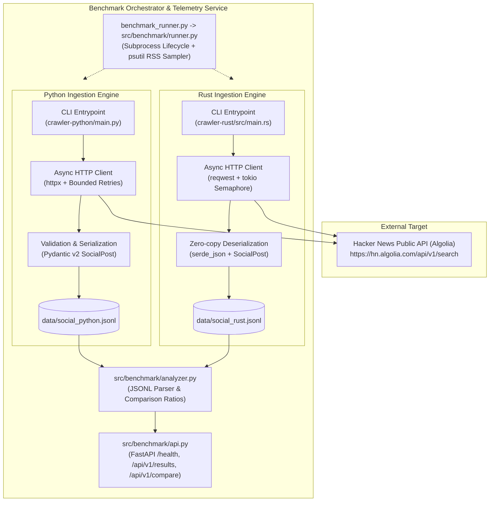

# Social Crawler & Ingestion Benchmark: Rust vs. Python

[](https://github.com/subki72/rust-vs-python-crawler-benchmark/actions/workflows/ci.yml)
[](https://www.python.org/downloads/)
[](https://www.rust-lang.org/)
[](LICENSE)

An end-to-end polyglot data engineering benchmark and FastAPI telemetry service comparing **Rust** (`tokio` + `reqwest` + `serde`) and **Python** (`asyncio` + `httpx` + `Pydantic v2`) for concurrent social data crawling, schema validation, and JSON Lines persistence.

---

## Architecture Overview



---

## Baseline Benchmark Results

Tested across **5 technical topics** (`rust`, `python`, `technology`, `ai`, `datascience`) with 3 paginated batches per topic (50 records/batch), yielding **750 social media submissions** in `data/social_python.jsonl` and `data/social_rust.jsonl`:

| Metric | Python Engine (`httpx` + `pydantic`) | Rust Engine (`reqwest` + `tokio` + `serde`) | Variance / Winner |
| :--- | :--- | :--- | :--- |
| **Total Ingested Records** | **750 posts** | **750 posts** | **100% Identical Parity** |
| **Elapsed Execution Time** | **12.73 seconds** | **12.38 seconds** | **Rust ~1.03x faster** |
| **Ingestion Throughput** | **58.89 posts/sec** | **60.59 posts/sec** | **Rust +1.70 posts/sec** |
| **Peak Memory Usage (RSS)** | **59.05 MB** | **13.30 MB** | **Rust is 4.4x more memory efficient** |

---

## Project Directory Structure

```text
rust-vs-python-crawler-benchmark/
├── .env.example                   # Environment configuration template
├── .flake8                        # Flake8 linting settings
├── .gitignore                     # Secret, cache, and build artifact exclusions
├── .pre-commit-config.yaml        # Local pre-commit validation hooks
├── CHANGELOG.md                   # Semantic release history
├── CONTRIBUTING.md                # Contributor standards and checklist
├── Dockerfile                     # Multi-stage non-root image (Rust + Python API)
├── LICENSE                        # MIT License
├── Makefile                       # Single-command lint, test, build, and run targets
├── README.md                      # Project documentation
├── SECURITY.md                    # Vulnerability reporting and security controls
├── benchmark_runner.py            # Backward-compatible CLI wrapper for src.benchmark
├── docker-compose.yml             # Local container stack definition
├── pyproject.toml                 # Project metadata, Ruff, and Pytest settings
├── requirements-lock.txt          # Locked Python dependency snapshot
├── requirements.txt               # Exact-pinned Python dependencies
├── uv.lock                        # Cross-platform uv dependency lockfile
├── crawler-python/                # Python asynchronous ingestion engine
├── crawler-rust/                  # Rust Tokio asynchronous ingestion engine
├── data/                          # Persisted JSONL ingestion datasets
├── docs/
│   └── RUNBOOK.md                 # Operations & incident response runbook
├── src/
│   └── benchmark/
│       ├── analyzer.py            # JSONL parser & comparative metrics calculator
│       ├── api.py                 # Hardened FastAPI telemetry & comparison service
│       ├── config.py              # Validated BenchmarkSettings & structured logging
│       ├── runner.py              # Subprocess execution & psutil peak RSS sampler
│       └── schemas.py             # Pydantic v2 contracts & traversal guards
└── tests/                         # Offline unit & FastAPI integration test suites
```

---

## Quickstart & Local Usage

### Prerequisites

- **Python**: `3.11+` (`pip` or `uv`)
- **Rust**: `1.70+` (`cargo`, `rustfmt`, `clippy`)
- **Docker** (optional, for containerized deployment)

### Setup & Verification via Makefile

```bash
# 1. Configure environment (optional overrides)
cp .env.example .env

# 2. Install Python dependencies
make install

# 3. Run Python and Rust linters
make lint

# 4. Run offline test suites (Python Pytest + Rust cargo test)
make test
make test-rust
```

### Run the Telemetry API Service

```bash
make run
# or via Docker Compose:
docker compose up --build
```

Available HTTP endpoints:
- `GET /health` — Readiness and liveness probe reporting dataset availability.
- `GET /api/v1/results` — Cached comparative report computed from `data/*.jsonl`.
- `POST /api/v1/compare` — Compare inline engine telemetry or persisted JSONL filenames.

### Run the Head-to-Head Crawler Benchmark

```bash
make run-benchmark
# or directly:
python benchmark_runner.py
```

---

## Data Contract & Governance

Both engines emit line-delimited JSON (`.jsonl`) conforming to the canonical `SocialPost` contract (`id`, `title`, `author`, `score`, `num_comments`, `url`, `created_utc`, `selftext`, `category`).
See [SECURITY.md](SECURITY.md) for vulnerability reporting, [CONTRIBUTING.md](CONTRIBUTING.md) for PR requirements, and [docs/RUNBOOK.md](docs/RUNBOOK.md) for operational diagnostics.
