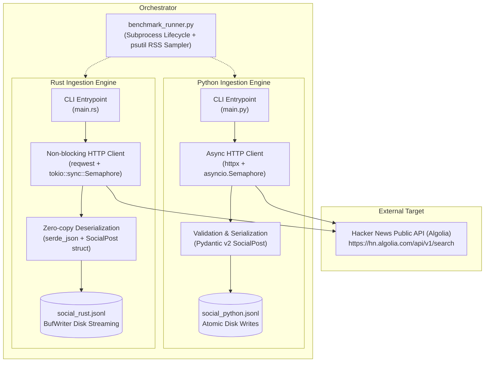

# Social Crawler & Ingestion Benchmark: Rust vs. Python

An end-to-end, production-grade data engineering benchmark comparing **Rust** and **Python** for high-throughput social data crawling, schema validation, and persistence.

---

## Architecture Overview



---

## Live Benchmark Results

Tested across **5 technical topics** (`rust`, `python`, `technology`, `ai`, `datascience`) with 3 paginated batches per topic (50 records/batch), yielding **750 social media submissions**:

| Metric | Python Engine (`httpx` + `pydantic`) | Rust Engine (`reqwest` + `tokio` + `serde`) | Variance / Winner |
| :--- | :--- | :--- | :--- |
| **Total Ingested Records** | **750 posts** | **750 posts** | **100% Identical Parity** |
| **Elapsed Execution Time** | **12.73 seconds** | **12.38 seconds** | **Rust ~1.03x faster** |
| **Ingestion Throughput** | **58.89 posts/sec** | **60.59 posts/sec** | **Rust +1.70 posts/sec** |
| **Peak Memory Usage (RSS)** | **59.05 MB** | **13.30 MB** | **Rust is 4.4x more memory efficient** |

---

## Technical Analysis: Why the Disparity?

### 1. Why is Execution Latency Similar? (~12.7s vs ~12.3s)
The workflow is **Network I/O-Bound**, not CPU-bound:
- **Network Latency Dominated**: Over 90% of the duration is spent waiting for remote server round-trips over TLS/TCP plus polite inter-request pacing (`100ms`).
- **Modern Non-blocking Runtimes**: Both Python (`asyncio` + `httpx`) and Rust (`tokio` + `reqwest`) utilize epoll/IOCP kernel event notification. When sockets wait on network packets, CPU consumption in both implementations drops to near zero.

### 2. Why is Memory Consumption Drastically Lower in Rust? (13.3 MB vs 59.1 MB)
- **Runtime Footprint**: Python requires a dynamic runtime (CPython VM, bytecode interpreter, symbol tables). Merely importing `httpx` and `pydantic` inflates baseline RSS to ~40 MB before the first HTTP packet arrives. Rust compiles directly to raw machine instructions with zero VM overhead (~3 MB base footprint).
- **Object Representation**: A single numeric integer in Python is a dynamically allocated `PyObject` (~28 bytes + dict pointers + reference count metadata). In Rust, `i64` occupies exactly 8 bytes contiguous in memory.
- **Garbage Collection vs. Deterministic Deallocation**: Python relies on generational GC and memory arenas (`pymalloc`), holding allocated heap blocks indefinitely. Rust deterministically reclaims memory the exact millisecond an entity exits scope via the `Drop` trait (RAII).
- **Zero-Copy Deserialization**: Rust's `serde_json` populates tightly-packed structs directly from read buffers without allocating intermediate dynamic dictionary wrappers.

---

## Project Directory Structure

```
social-crawler-benchmark/
├── README.md                      # Comprehensive project documentation
├── benchmark_runner.py            # Automated benchmark harness & RSS profiler
├── data/                          # Output directory for ingested JSON Lines
│   ├── social_python.jsonl        # 750 records serialized by Python
│   └── social_rust.jsonl          # 750 records serialized by Rust
├── crawler-python/                # Python Ingestion Engine
│   ├── requirements.txt           # httpx, pydantic, psutil
│   ├── models.py                  # Pydantic v2 SocialPost domain model
│   ├── parser.py                  # Defensive JSON response decoder
│   ├── crawler.py                 # Async client with connection pooling & semaphores
│   └── main.py                    # Production CLI runner
└── crawler-rust/                  # Rust Ingestion Engine
    ├── Cargo.toml                 # Dependencies: tokio, reqwest, serde, anyhow
    └── src/
        ├── models.rs              # Strongly-typed serde domain structs
        ├── parser.rs              # Zero-copy JSON payload extractor
        ├── crawler.rs             # Tokio async client with bounded semaphore
        └── main.rs                # BufWriter-accelerated streaming CLI runner
```

---

## Getting Started

### Prerequisites
- **Python**: 3.10+ with `pip`
- **Rust**: 1.75+ with `cargo`

### 1. Install Python Dependencies
```bash
cd social-crawler-benchmark/crawler-python
pip install -r requirements.txt
```

### 2. Build Rust Release Executable
```bash
cd ../crawler-rust
cargo build --release
```

### 3. Run the Comparative Benchmark
From the `social-crawler-benchmark` root directory:
```bash
python benchmark_runner.py
```

---

## Data Contract (Schema)

Both engines emit atomic, line-delimited JSON (`.jsonl`) adhering to the following schema:

```json
{
  "id": "22238335",
  "title": "Why Discord is switching from Go to Rust",
  "author": "Sikul",
  "score": 1582,
  "num_comments": 642,
  "url": "https://blog.discordapp.com/why-discord-is-switching-from-go-to-rust-a190bbca2b1f",
  "created_utc": 1580837440.0,
  "selftext": null,
  "category": "rust"
}
```

---

## Architectural Recommendations for Data Engineering

1. **When to Choose Rust for Ingestion**:
   - Continuous 24/7 background scraping / polling services running on low-spec cloud VMs (low RAM costs).
   - High-concurrency pipelines (thousands of simultaneous web sockets or long-polling streams).
   - Compute-heavy post-processing (HTML DOM sanitization, large-scale regex parsing, compression).
2. **When to Choose Python for Ingestion**:
   - Rapid prototyping, exploratory analysis, and fast-changing external schemas.
   - Downstream ETL pipelines leveraging Pandas, Polars, PySpark, or machine learning model inference.
3. **The Recommended Hybrid Architecture**:
   - Deploy **Rust** as the lightweight edge collector/ingestor to persist raw payloads into Parquet / Kafka / S3.
   - Consume and transform those payloads in **Python** for analytics, feature stores, and AI models.
